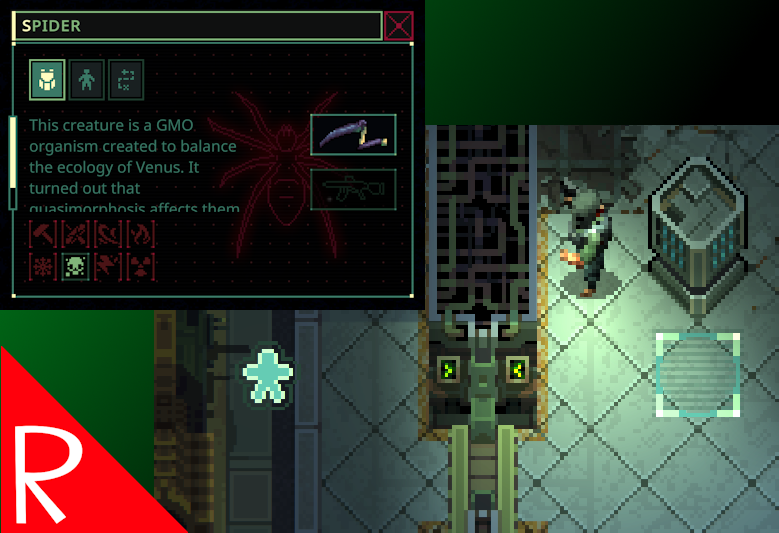

# Command Ally

Command Ally adds two quality-of-life features for allied units:

- **Remote commands:** Give commands to normally commandable ally units when they are out of line of sight, including robots, spiders, and revived soldiers. This is useful for leaving a unit with a "stand" command as a mule and recalling it when you need to load it.

- **Follower backpack access:** Ever had to fight getting one space away from your follower to open their inventory? Now you can open a follower ally's inventory from two cells away. This can be adjusted in the mod configuration menu when Mod Config Menu is installed.  The game's default is 1.

# Buy Me a Coffee
If you enjoy my mods and want to buy me a coffee, check out my [Ko-Fi](https://ko-fi.com/nbkredspy71915) page.
Thanks!

# Source Code
Source code is available on GitHub at https://github.com/NBKRedSpy/CommandAlly

# Change Log
The change log can be found at https://github.com/NBKRedSpy/CommandAlly/blob/main/CHANGELOG.md